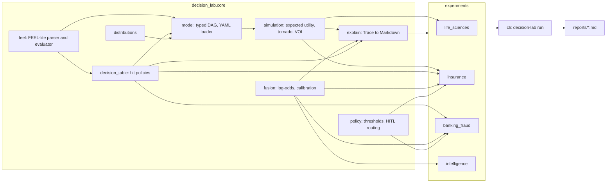

# decision-model-lab

Decision intelligence experiments: one decision-modelling toolkit (decision graphs, evidence fusion, simulation and explainable recommendations) applied to four domains: life sciences, insurance, banking fraud and intelligence analysis.


## What it demonstrates

- **Typed decision graphs.** A decision model is a DAG of levers (choices), externals (uncertain inputs with distributions), intermediates, outcomes (with utility weights) and constraints, in the spirit of causal decision diagrams and the DMN decision requirements graph. Models are written in YAML or Python; edges are derived from the expressions, and the validator checks references, node-type rules and acyclicity.
- **DMN-style decision tables** with UNIQUE, FIRST and COLLECT (LIST, SUM, MIN, MAX, COUNT) hit policies, evaluated by a FEEL-lite engine: a hand-written tokenizer and recursive-descent parser with no `eval()`, null semantics, intervals, unary tests, and element-wise evaluation over arrays so one table can route a whole batch.
- **Monte Carlo decision analysis**: expected utility per lever setting on common random numbers, chance constraints, tornado sensitivity with first-order variance shares, and value of information (EVPI, EVPPI, and EVSI for an imperfect study).
- **Evidence fusion and calibration**: naive-Bayes fusion in log-odds space with reliability-discounted likelihood ratios, a multi-hypothesis update, Platt and isotonic calibration, Brier score, expected calibration error and reliability tables.
- **Human-in-the-loop policy**: auto-act / human-review / reject routing, a cost-sensitive threshold optimiser with an optional capacity limit, and a two-threshold routing optimiser with a review-capacity cap.
- **Explanations as data**: every recommendation returns a `Trace` (rules fired, top evidence by log-likelihood ratio, sensitivity drivers, notes) that renders to Markdown.

## Architecture



The core has no domain knowledge. `feel` is the only place expressions are parsed, so the model (expression nodes), the decision tables (input and output cells) and the DAG edge derivation all share one grammar. `simulation` works on any `DecisionModel`; the experiments supply a model, a synthetic data generator and the domain reasoning, and return a `Report` that the CLI writes to `reports/<domain>.md`. Each experiment uses the parts of the toolkit its problem needs.

## Quickstart

Requires Python 3.12 or later. Dependencies: numpy, scikit-learn, PyYAML (pytest and ruff for development).

```bash
python3 -m venv .venv
source .venv/bin/activate
pip install -e ".[dev]"

decision-lab run all              # writes reports/<domain>.md and prints a summary
decision-lab run insurance        # one domain
decision-lab run intelligence --seed 9
python experiments/life_sciences/run.py   # same thing, per-domain script

ruff check . && ruff format --check .
pytest
```

Example reports are committed under [`docs/examples/`](docs/examples/).

A model in YAML (a shortened form of the toy model used in the tests):

```yaml
name: newsvendor
parameters: {price: 10, cost: 6}
nodes:
  - {name: order, kind: lever, options: [0, 50, 100]}
  - {name: demand, kind: external, distribution: {dist: normal, mean: 100, sd: 20}}
  - {name: sold, kind: intermediate, expr: "min(order, max(demand, 0))"}
  - {name: profit, kind: outcome, expr: "sold * price - order * cost"}
  - {name: cap, kind: constraint, expr: "order <= 80"}
```

```python
from decision_lab.core import DecisionModel, simulate, tornado, value_of_information

model = DecisionModel.from_yaml("newsvendor.yaml")
result = simulate(model, n=20_000, seed=1)
best = result.best()
print(best.levers, best.expected_utility)
print(tornado(model, best.levers)[0].external)
print(value_of_information(result, "demand").value)
```

## Experiments

All data is synthetic and produced by seeded generators. Each script prints a short summary and writes a full report.

### 1. Life sciences: drug-discovery portfolio prioritisation

Eight fictional programmes across preclinical, phase 1, 2 and 3. Levers are fund or do not fund per programme (256 settings) under a budget constraint. Externals per programme are the probability of technical success (beta priors by phase), time to market (triangular), peak sales (lognormal) and a technical outcome draw. One preclinical asset also carries a hidden toxicity flaw. The outcome is portfolio NPV. The report ranks portfolios by expected NPV with P10, P90 and probability of loss, shows a tornado of the recommended portfolio's drivers, and computes EVPI, the EVPPI of knowing the toxicity outcome, and the EVSI of an 85 percent accurate extra preclinical study against its cost, including which portfolio to fund after each readout.

### 2. Insurance: claims triage

Claims are routed fast-track, standard or investigate by a FIRST-hit-policy decision table that is a node inside a YAML decision model ([`triage_model.yaml`](experiments/insurance/triage_model.yaml)). Its input cells reference two threshold levers. The fraud likelihood comes from fusing six red-flag indicators in log-odds. The generator correlates the flags through a hidden "organised ring" factor, so the naive-Bayes score is miscalibrated in the middle range, and isotonic calibration on a held-out split corrects it. The claims backlog is fed in as observed-data externals, and the grid search over thresholds reports the leakage vs handling cost vs customer friction trade-off. The chosen threshold is compared with the analytic Bayes threshold from the cost matrix. Per-claim traces list the fired rule and the top red flags.

### 3. Banking fraud: alert disposition under investigator capacity

Twenty days of synthetic transactions. Days 0 to 9 train a gradient boosting classifier, days 10 to 13 fit Platt scaling and choose thresholds, and the last six days are held out. The cost-optimal threshold would generate far more alerts than the team can work, so the capacity-constrained optimiser raises it until the queue fits. Three strategies are compared out of sample: rules only (a COLLECT MAX table of hard rules), model only, and model plus rules (hard rules always alert, remaining capacity ranked by probability times amount). A three-lane routing policy (auto-block, review, release) is fitted under a review-capacity cap. Traces explain each lane with fired rules and per-feature ablation contributions.

### 4. Intelligence analysis: competing hypotheses

A fictional outage at a port with four competing hypotheses. Evidence items are rated against each hypothesis on the classic ACH scale (CC, C, N, I, II), which maps to likelihoods. A seeded generator picks the true hypothesis and simulates which items are reported, by which sources, and at what Admiralty grade (reliability A to F, credibility 1 to 6). Unreliable sources report noise. The report shows the ACH matrix sorted by diagnosticity, the classic inconsistency score next to a reliability-weighted Bayesian posterior, and a "what would change the conclusion" section: linchpin items (leave one out), sources whose fabrication would flip the lead, and unreported items that collection could target. A test checks that over 30 seeds the true hypothesis leads more often than any other.

## Design decisions

1. **Derive DAG edges from expressions instead of declaring them.**
   *Why:* hand-declared dependencies drift away from the logic they describe. Parsing each node's expression (or decision table cells) for free names makes the graph a faithful view of the computation, and the validator can then enforce typing rules such as "constraints are sinks" and "levers have no parents".
   *Trade-off:* Python callable nodes must still declare `depends_on`, and parameters (constants) have to be separated from nodes so they do not appear as edges.

2. **A hand-written FEEL subset rather than `eval()` or a full FEEL implementation.**
   *Why:* decision tables are often edited by analysts, so the expression language is an attack surface. A tokenizer plus recursive-descent parser with an allow-listed function table and no attribute access cannot reach the interpreter. The subset (arithmetic, comparisons, three-valued logic with null, intervals, `in`, `between`, `if/then/else`, unary tests) covers what the tables in this repo need, in about 450 lines.
   *Trade-off:* no contexts, date and time types, `for` or quantified expressions. Tables that need those would need a fuller engine.

3. **Array-aware evaluation, with common random numbers across policies.**
   *Why:* the same FEEL expression scores one case for an explanation trace or 20,000 Monte Carlo samples for a policy comparison. Evaluating every lever setting on the same sampled externals removes sampling noise from the differences between policies. One seeded child stream per external means adding a new input does not change the samples of existing ones, so results stay comparable across model edits.
   *Trade-off:* full lever grids grow combinatorially (256 portfolios is fine, 2^30 is not). A larger problem would need a solver over the levers instead of enumeration.

4. **Calibrate before thresholding, and fit thresholds out of sample.**
   *Why:* a cost matrix only gives the right threshold if the scores are probabilities. Naive-Bayes fusion overstates confidence when evidence is correlated, and boosted trees are not calibrated by construction. In the banking experiment the model, the calibrator and the thresholds are each fitted on separate days, so the reported net benefit is not tuned on the data it is measured on.
   *Trade-off:* every split reduces training data. Isotonic calibration needs more data than Platt scaling and produces step functions with ties.

5. **Treat capacity as a constraint of the decision, not a tuning knob.**
   *Why:* in alert handling the binding constraint is usually the number of investigators, not the cost ratio. The optimiser minimises expected cost subject to a maximum flagged count, and the combined strategy spends the fixed capacity on expected loss (probability times amount) instead of raw probability, and fills the queue to capacity instead of leaving slack when few scores clear the threshold.
   *Trade-off:* a daily cap ignores queue dynamics (backlog carried over, alert ageing, investigator skill). A queueing simulation would be the next step.

6. **Explanations are structured data first, Markdown second.**
   *Why:* a `Trace` carries fired rules, signed log-likelihood contributions and sensitivity drivers as typed fields. Tests assert on them, and a downstream system could store them for audit. Log-odds fusion makes evidence contributions additive, so "why" has an exact answer, not an approximation.
   *Trade-off:* for the boosted model the per-feature contributions come from single-feature ablation, which is cheap and model-agnostic but ignores interactions. Additive attributions would need a dedicated method.

## Scope and limits

- No full DMN or FEEL conformance: no DMN XML import or export, no boxed expressions, contexts, temporal types or business knowledge models.
- No optimisation solver over levers: lever settings are enumerated.
- Sensitivity is one-at-a-time plus first-order variance shares, not total-order indices.
- The naive-Bayes fusion assumes conditional independence. The insurance experiment shows the failure mode and repairs it with calibration, but does not model the dependence.
- Source reliability in the ACH experiment is a single mixture weight per report, with no model of correlated or deceptive source networks.
- The cost and value figures in all four domains are invented and only illustrate the method.
- No LLM components and no network calls.

## About this lab

A compact reference implementation written in 2026. It reconstructs, on synthetic data, patterns I have used in production systems (decision models with rule tables, evidence fusion with calibrated scores, and human-in-the-loop routing), without reproducing any proprietary design.

## License

MIT. See [LICENSE](LICENSE).
