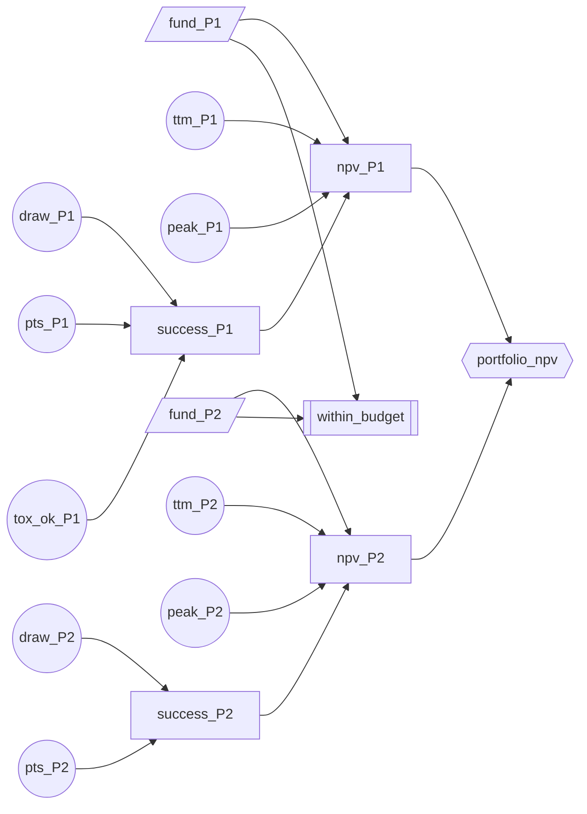

# Life sciences: drug-discovery portfolio prioritisation

Synthetic data, seed 7. Generated by `decision-lab run life_sciences`.

## Summary

- recommended portfolio: P2 P3 P4 P8 (spend 379/420 M)
- expected NPV 628 M, P10 -379, P90 2,024
- top NPV driver: peak_P8 (swing 532 M)
- toxicity study on P1: EVSI 2.5 M vs cost 6.0 M -> skip it

## Programmes

| Programme | Phase | Remaining cost (M) | Median peak sales (M) | PTS prior mean |
|---|---|---|---|---|
| P1 | preclinical | 48.4 | 1,045.0 | 0.070 |
| P2 | preclinical | 37.6 | 717.0 | 0.070 |
| P3 | phase1 | 56.3 | 1,759.0 | 0.110 |
| P4 | phase1 | 78.5 | 1,150.0 | 0.110 |
| P5 | phase2 | 127.9 | 565.0 | 0.220 |
| P6 | phase2 | 154.8 | 460.0 | 0.220 |
| P7 | phase3 | 279.1 | 472.0 | 0.580 |
| P8 | phase3 | 207.0 | 478.0 | 0.580 |

Budget: 420 M. 256 lever settings evaluated, 95 within budget, 20,000 Monte Carlo samples each (common random numbers).

## Top portfolios by expected NPV

| Portfolio | E[NPV] (M) | SD | P10 | P90 | P(NPV < 0) |
|---|---|---|---|---|---|
| P2 P3 P4 P8 | 628.0 | 1,353.4 | -379.4 | 2,024.3 | 0.333 |
| P1 P3 P4 P8 | 614.8 | 1,363.3 | -390.2 | 2,043.7 | 0.340 |
| P3 P4 P8 | 606.0 | 1,325.3 | -341.8 | 1,940.4 | 0.344 |
| P3 P5 P8 | 590.6 | 1,298.9 | -391.2 | 1,812.8 | 0.325 |
| P1 P2 P3 P8 | 558.3 | 1,290.5 | -349.3 | 1,724.5 | 0.348 |
| P2 P3 P8 | 549.5 | 1,251.1 | -300.9 | 1,598.2 | 0.355 |

## Tornado: what drives the NPV of the recommended portfolio

Each external is pinned at its 10th and 90th percentile while the others stay random.

| External | Low value | High value | E[NPV] at low | E[NPV] at high | Swing | First-order variance share |
|---|---|---|---|---|---|---|
| peak_P8 | 279.0 | 828.4 | 374.2 | 905.9 | 531.7 | 2% |
| peak_P3 | 715.2 | 4,484.1 | 425.5 | 868.0 | 442.5 | 2% |
| pts_P3 | 0.052 | 0.176 | 470.2 | 773.2 | 303.1 | 1% |
| pts_P8 | 0.451 | 0.705 | 495.9 | 715.3 | 219.4 | 0% |
| peak_P4 | 584.3 | 2,251.0 | 522.1 | 723.9 | 201.8 | 0% |
| pts_P4 | 0.053 | 0.177 | 527.7 | 701.8 | 174.0 | 0% |
| peak_P2 | 270.1 | 1,842.8 | 568.3 | 667.1 | 98.8 | 0% |
| pts_P2 | 0.026 | 0.123 | 570.0 | 652.4 | 82.4 | 0% |

The variance shares are small because most NPV variance comes from the binary technical outcome of each programme (succeed or fail), which is not a lever-relevant input and is left out of the tornado. The swings show which estimates are worth refining.

## Value of information: extra preclinical toxicity study on P1

| Quantity | Value (M) |
|---|---|
| EVPI, all uncertainty resolved (upper bound) | 758.3 |
| EVPPI, toxicity of P1 known exactly | 8.176 |
| EVSI, study with 85% accuracy | 2.515 |
| Study cost | 6.000 |
| Net value of running the study | -3.485 |
| EVPPI of the top tornado driver (peak_P8) | 44.9 |

Portfolio chosen after each study readout:

- readout clean: fund P1 P3 P4 P8
- readout toxicity signal: fund P2 P3 P4 P8

## Explanation trace

### Recommendation

**Recommendation:** fund P2, P3, P4, P8 (spend 379 of 420 M)
**Score:** 628.026

Sensitivity drivers:

- peak_P8: swing 531.7, variance share 2%
- peak_P3: swing 442.5, variance share 2%
- pts_P3: swing 303.1, variance share 1%

- expected NPV 628 M, P(NPV < 0) 33%
- runner-up P1 P3 P4 P8 is 13 M lower
- skip the toxicity study: EVSI 2.5 M vs cost 6.0 M

## Decision graph

